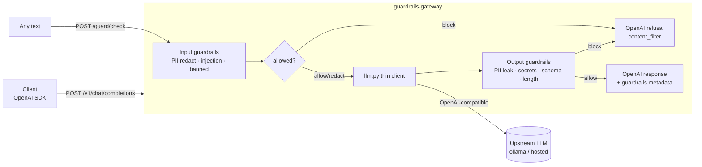

# guardrails-gateway

**A drop-in safety proxy for any OpenAI-compatible LLM. Point your client at it instead of the provider, and it enforces input + output guardrails on every call.**

## The problem

Shipping an LLM feature means owning its failure modes: users paste PII into prompts, attackers try prompt injection, and the model can leak secrets, drift off-topic, or return malformed JSON. Bolting those checks into every app, one at a time, does not scale. `guardrails-gateway` puts them in one place: a proxy that speaks the OpenAI API, so you get the guardrails by changing a base URL.

> **Honesty note.** These are **heuristic** defenses (curated regex + phrase matching), not a guarantee. The gateway is a triage/drafting aid. Outputs are AI-generated and every decision needs human review.

## What it does

- Exposes an OpenAI-compatible `POST /v1/chat/completions`. It runs **input** guardrails on the prompt, forwards the (possibly redacted) request upstream through a thin `llm.py` (local ollama by default), then runs **output** guardrails before returning the response.
- Exposes `POST /guard/check` to run the guardrails on arbitrary text and get the verdict **without** calling an LLM.
- Guardrails (all deterministic, configured by a YAML policy, each returns `allow` / `redact` / `block` + reasons):
  - **PII** detection + redaction: emails, phone, credit-card (Luhn-validated), SSN-like, IP. Redacted in input, blocked if it leaks in output.
  - **Prompt-injection** heuristics: override phrases ("ignore previous instructions", "reveal your system prompt"), jailbreak markers.
  - **Banned-topics** blocklist (configurable keywords).
  - **Output JSON-schema** enforcement when the caller asks for structured output.
  - **Secret egress** (private-key headers, OpenAI/AWS key shapes) and a max-length cap.
- On block it returns a well-formed OpenAI refusal (`finish_reason: "content_filter"`) with the reasons, and never crashes. Every decision is labelled in a `guardrails` metadata block on the response.

## Architecture



## Quickstart

```bash
# 1. install
make install

# 2. run the offline test suite (no network, no API key needed)
make test

# 3. start the gateway (defaults to local ollama upstream)
make run        # serves http://127.0.0.1:8000

# 4. run guardrails on text WITHOUT any LLM (works fully offline):
curl -s localhost:8000/guard/check \
  -H 'content-type: application/json' \
  -d @samples/requests/guard_check_pii.json | python3 -m json.tool

# 5. proxy a chat completion (needs an upstream LLM running, e.g. `ollama serve`):
curl -s localhost:8000/v1/chat/completions \
  -H 'content-type: application/json' \
  -d @samples/requests/chat_clean.json | python3 -m json.tool
```

### Install as a CLI

```bash
pipx install git+https://github.com/aminafara123/guardrails-gateway
guardrails-gateway        # starts the server on 127.0.0.1:8000
```

## Sample run

Running the guardrails on a prompt containing PII (no LLM call):

**Input** (`POST /guard/check`):
```json
{ "text": "Hi, I'm Bob, email bob@acme.com, card 4111 1111 1111 1111." }
```

**Output:**
```json
{
  "action": "redact",
  "redacted_text": "Hi, I'm Bob, email [REDACTED_EMAIL], card [REDACTED_CREDIT_CARD].",
  "reasons": [
    { "rule": "pii_redaction", "detail": "redacted 2 PII item(s): {'email': 1, 'credit_card': 1}" }
  ],
  "findings": { "pii": [ { "type": "email", "start": 19, "end": 31 }, { "type": "credit_card", "start": 38, "end": 57 } ] },
  "note": "AI-generated output passed through heuristic guardrails ... A human must review."
}
```

A blocked prompt (`POST /v1/chat/completions` with "ignore previous instructions...") short-circuits **before** any upstream call and returns an OpenAI refusal with `finish_reason: "content_filter"`.

## How it works

- `guardrails.py` is the deterministic core: pure functions over `(text, policy)`. PII is curated regex plus a **Luhn** check for cards (real vs. fake), overlaps resolved longest-match-wins so a 16-digit card is not also tagged as a phone number. Injection and banned-topics are case-insensitive phrase matches. Output checks add secret-pattern egress, a length cap, and optional `jsonschema` validation.
- `app.py` is the FastAPI layer: input block decision over all messages, PII redaction per message so the forwarded request stays well-formed, forward via `llm.py`, then output checks. Blocks return a valid OpenAI body; a clean response carries a `guardrails` metadata block.
- `llm.py` is the only code that touches a model: one function calling an OpenAI-compatible `/chat/completions`, configured purely by env, defaulting to local ollama. If the upstream is unreachable it degrades to a clear `502`, never a crash.
- `policy.yaml` is the single source of truth for what to redact, block, and enforce. Point `GATEWAY_POLICY` at your own to retune without code changes.

The deterministic core is what the offline test suite exercises (the model is mocked), so `pytest -q` passes with no network and no key.

## Tech stack

FastAPI · Uvicorn · Pydantic v2 · PyYAML · httpx · jsonschema · pytest. Python >= 3.9.

## Demo


See [DEMO.md](DEMO.md) for a 60-second recording script.

## Configuration

| Env var | Default | Purpose |
|---|---|---|
| `LLM_BASE_URL` | `http://127.0.0.1:11434/v1` | Upstream OpenAI-compatible endpoint |
| `LLM_MODEL` | `qwen3:30b-a3b-instruct-2507-q4_K_M` | Upstream model name |
| `LLM_API_KEY` | `ollama` | Passed as bearer token (ollama ignores it) |
| `GATEWAY_POLICY` | bundled `policy.yaml` | Path to a custom policy file |
| `GATEWAY_HOST` / `GATEWAY_PORT` | `127.0.0.1` / `8000` | Where the server listens |

## Limitations (by design)

- Non-streaming responses only (streaming would need the output guardrails to run incrementally over SSE chunks).
- PII is curated regex + Luhn, not an ML NER, so free-form names and novel formats are out of scope.
- Heuristic defenses, not a security guarantee. Keep a human in the loop.

## License

MIT © 2026 Al Amin Bashir Afara. See [LICENSE](LICENSE).
